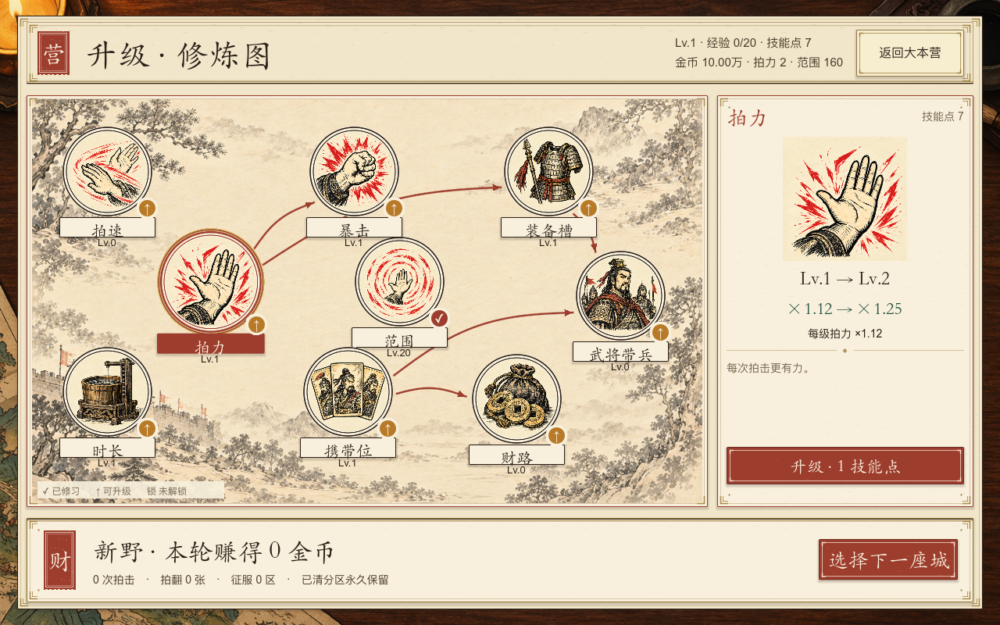
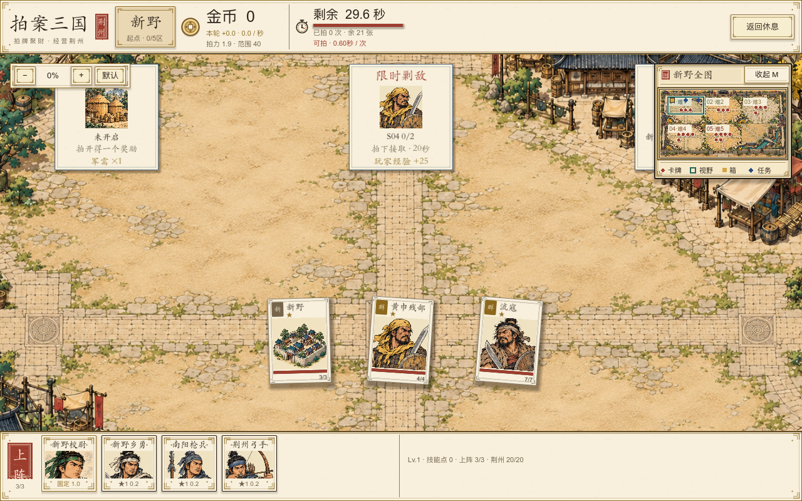
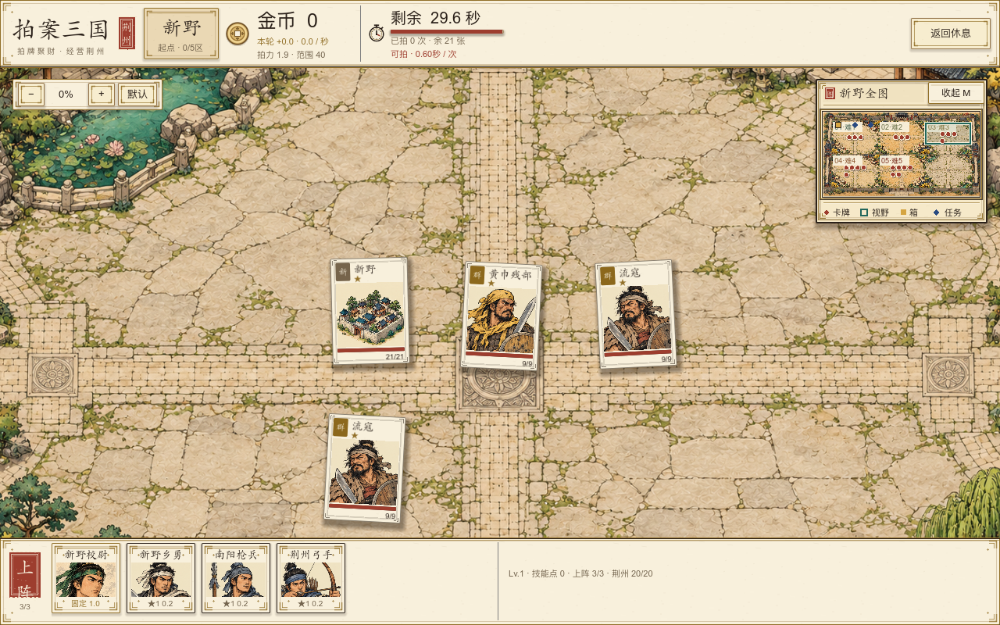

# 修炼图与城坊美术迭代

2026-10-17。按用户提供的修炼图参考实现，图片均为原生Godot运行截图，使用隔离测试档；升级截图含测试构筑和技能点，不表示普通玩家开局能取得这些等级。

## 升级页

九个圆形插画节点、真实技能前置箭头、右侧独立详情和唯一升级按钮。每次升级只扣1技能点，选节点不消费；挂机技能没有恢复。新生成的九宫格插画和淡山水底已接入，图集采用独立UV圆形裁切，右侧完整保留图案。

[720高度](cultivation-720.png)。

## 分区场地

三种场地为坊市、军营、园林。每区按固定世界矩形绘制，不再把整个作战场地图拉成不同长宽比；旧全城图只填外围，不满一行的空格用同尺度园林补景，不新增敌牌。去掉整区色膜和调试式直角边框，改为纸签，难度只在小地图小题签中着色。未改敌牌位置、判定、地图坐标和任务规则。

[军营](800/map-garrison.png) · [全城概览](800/map-overview.png) · [720场地](720/map-market.png) · [相同镜头的改动前](map-before.png)。

坊市做了两轮：第二轮降低地面纹理密度与对比；第一轮保留在 `assets/art_v13/district_market.png`，当前采用 `district_market_v2.png`。三类场地会复用在不同分区，尚未为21座城各绘专属地图。

## 出图来源与验证

使用内置image_gen，完整提示词、尺寸和用途见[生成记录](../../assets/art_v13/generation.json)。实际文件尺寸已用sips核对：九宫格1254×1254、山水1586×992，三种运行场地1472/1473×1068。

原生 `CultivationGraphTest`：121项通过，覆盖720/800真实鼠标选择、前置、技能点消费、时长预览和页内边界。`AdventureUITest` 26项通过，`MapEventsTest` 62项通过。未将截图测试表述为完整21城人工通关。
