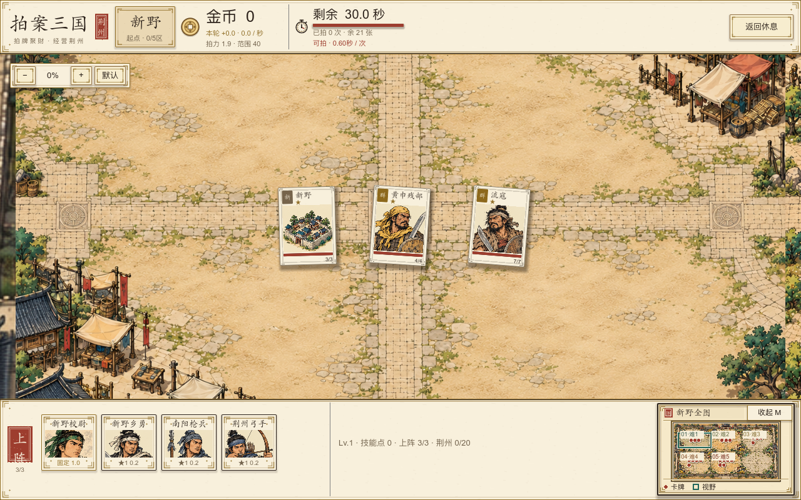
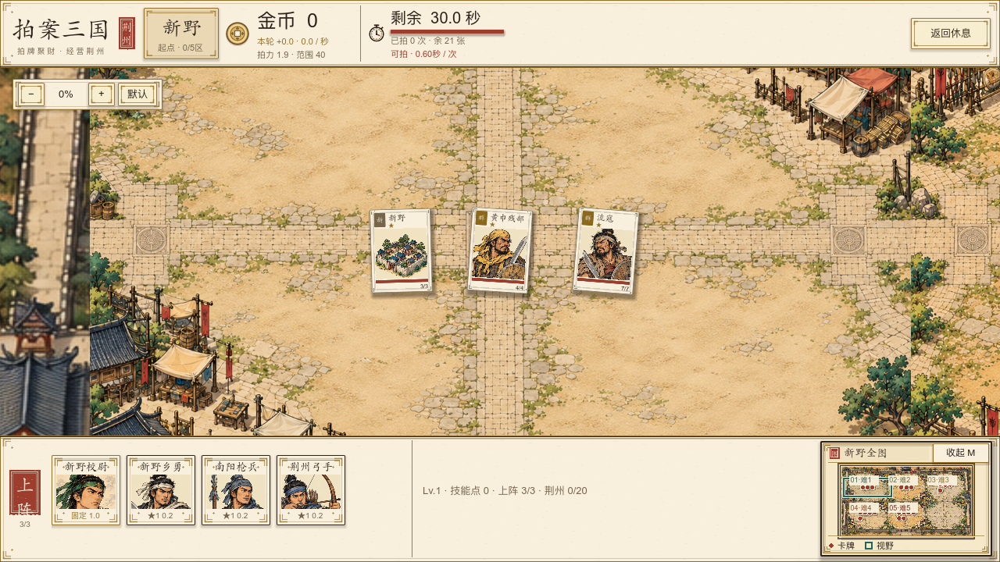
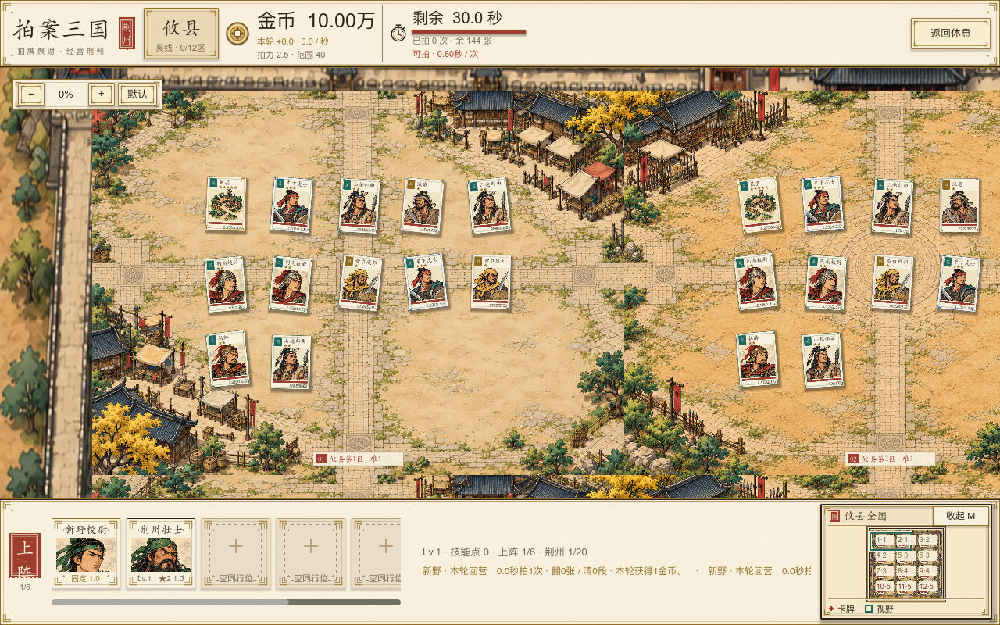
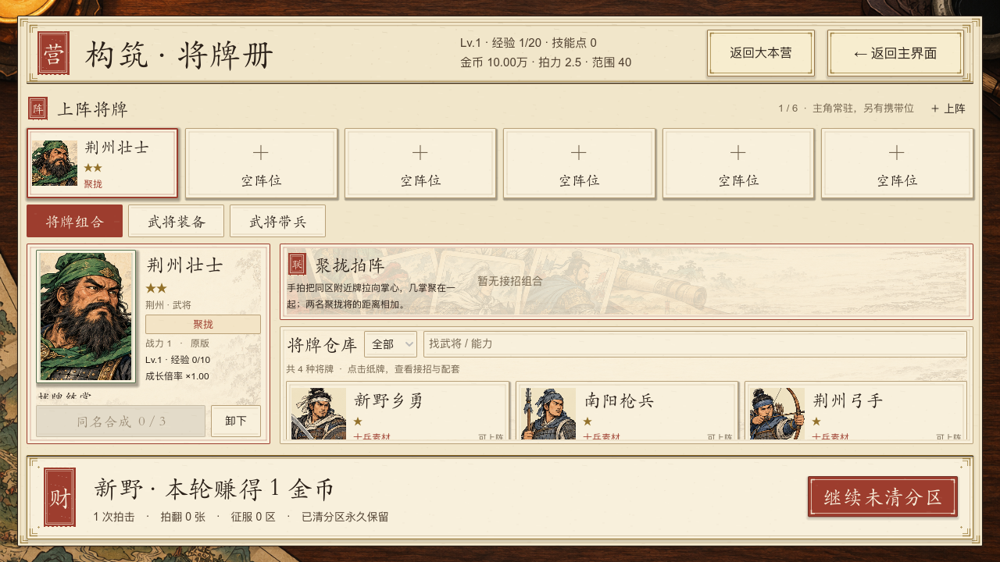
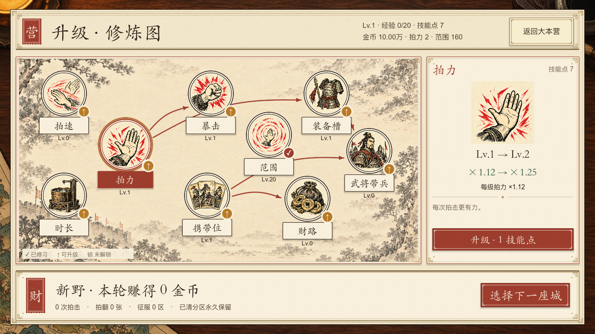

# 地图与文字布局验收 · 2026-10-17

本轮按用户确认隐藏任务和宝箱：战斗、巡城都不画事件卡、护卫目标或小地图事件标记，隐藏事件不参与拍击命中。底层规则与事件数据保留。

小地图放入底部栏右侧，展开尺寸220×148；点击定位、拖动和M键收放保留。底栏高度随收放调整，镜头维持同一世界焦点。后期窄分区使用“区号·难度”短签，并把纸签画在红点上方。

修炼节点按实际字高绘制名称框，将等级排在框下；调整范围节点位置与命中区，避免透明按钮留白遮住其他技能。构筑页修复空阵位文字越框，六阵位缩小头像给名称留位；长名称与特性在有限宽度内省略，悬停保留全文。休息页跟随窗口变化，战果栏不再留在屏幕外。金币数值按内容留宽，保留“万”等单位。

## 验证

Godot 4.7.2，隔离测试档：

| 检查 | 结果 | 范围 |
| --- | --- | --- |
| AdventureUITest，原生窗口 | 95项，0失败 | 720/800底栏边界、真实点击定位、收放焦点、隐藏事件不拦敌牌、六阵位文字、战果栏与高额金币 |
| CultivationGraphTest，原生窗口 | 175项，0失败 | 九节点实际点击、唯一消费按钮、名称字高与等级边界、720/800布局 |
| CityExplorationTest，无头 | 211项，0失败 | 世界坐标、小地图映射、边缘平移、输入阻挡与720布局 |

这是针对本次改动的验证，不等于完整21城人工通关。截图来自实际运行；高金币、技能点与六阵位是验收用数据。

## 画面对照

1280×800，隐藏事件及底栏小地图：

1280×720：

后期十二分区：

六阵位及文字边界，1280×720：

修炼图，1280×720：

[构筑800](deck-six-800.png) · [修炼800](cultivation-800.png)
