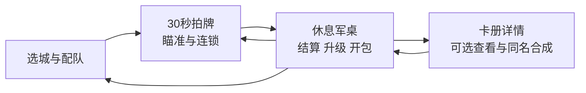

# 《拍案三国》100元目标精简策划案

版本：方向提案 v1.0｜2026-10-16  
定位：人民币100元左右的PC单机买断体验。候选标价可测试98元；本文没有证明玩家愿意为当前版本支付这一价格。  
范围：简化规则、玩法深度、内容预算、美术与声音改进、验证和迁移方案。本次只交付策划，不修改玩法代码。

## 1. 产品决定

**一句话：用一掌掀翻三国牌阵，用三名武将把这一掌接成连锁。**

保留古代荆州校尉筹军资的设定，以及纸本三国、圆圈拍牌、翻牌收钱、休息开包的身份。让玩家持续做三件事：选择先拍哪里、凑出一套能接招的队伍、打穿一种新的敌阵。

100元的体验目标由四件事支撑：

1. **手感：**纸牌有重量，落掌、翻面、连锁、收钱形成可辨认的连续反馈。
2. **选择：**换一套队伍会改变目标顺序、瞄准位置和收割时机。
3. **完整内容：**从新野起家到江陵收束，有逐步变化的敌阵、首领和结局。
4. **成品质量：**说明准确、读得清、存得住、操作可调，连续游玩不会被重复菜单拖住。

本案选择减少养成菜单，把制作资源集中到上述四项。联网、赛季、每日任务、真实货币抽卡、更多货币、重新引入武将经验等级不进入首发范围。

## 2. 当前项目的真实起点

| 当前事实 | 对策划的含义 |
| --- | --- |
| 169张数据卡：57武将、24士兵、36装备、30建筑、21城池、1初始武将 | 已有大量图像和数据可复用，首发无需先扩数量 |
| 21城、9类包、13项修炼；每将装备和带兵、逐城建筑都在运行 | 玩家需要理解的管理层多于核心输入动作 |
| 武将独立金币等级已退役，现为同名三张提升品相 | 保留现有成果，避免按旧策划重复迁移 |
| 当前正常输入只有圆圈单击轻拍；正常入口固定传入 `heavy=false` | 部分依赖重拍的技能需要重新接入常规操作 |
| 文聘雷爆、韩玄起火仍依赖重拍；六将三组机制存在后端逻辑 | 当前不能按“三套完整可玩流派”计算成品内容 |
| 城池各段重复使用区域敌人池，主要调整血量、牌数和阶段 | 应优先增加敌阵规则与布局差异 |
| 已完成休息期开包升级、逐张翻牌、默认0%镜头；基础包实际40金币 | 新方案沿用这些刚确认的行为 |
| 静态检索未发现音频素材、播放链与完整音量设置；字体使用系统字体回退 | 声音与跨平台排版需要列为产品制作任务；未做本轮听觉实测 |

事实依据见第12节。旧版“操场、青梅、有限耐力、自动尚未实现”的文档不能作为当前基线。

## 3. 推荐的简化结构

### 3.1 玩家只管理一套队伍

**目标结构：三名武将＋一张全队军略。** 两名武将组成发动机，第三名补短板；军略改变一种打法规则。

| 模块 | 推荐目标 | 资产如何复用 |
| --- | --- | --- |
| 武将 | 固定三名上阵；主角作为玩家身份与落掌表现，不额外增加配装页 | 从现有角色中筛选功能明确的武将；其他头像保留，逐批审核 |
| 装备与士兵 | 合并为全队一张军略；暂取消逐将五装备、逐将三兵位的管理 | 装备、士兵和部分功能建筑的图像与规则可成为军略候选 |
| 金币修炼 | 主要可购买项收敛为拍力、范围 | 拍速由章节里程碑提升；主线轮时长先固定30秒验证 |
| 自动、续轮、离线 | 合成“营地练习”，完成首城后一次解锁 | 统一开关、收入说明与离线报告；只练已经掌握的内容 |
| 基建 | 下放为章节营地建设与自动军需收入，取消逐城六槽的第二套构筑 | 农田、水井、粮仓等插画展示营地成长，关键功能随剧情或里程碑开放 |
| 卡包 | 目标版仅保留将牌包、军略包两类；按章节更新可见池 | 包装、卡背、逐张翻转复用；主线关键发动机给确定来源 |
| 重复卡 | 只保留同名三张提升品相；规则和材料统一在卡牌详情 | 收藏与品相记录保留；已上阵卡继续受保护 |
| 收藏 | 作为可选副页，承载插画、来源、合成和使用记录 | 城池卡可转纪念卡，不进入战斗配队卡池 |

上述为目标版取舍。先用独立试玩档验证固定三将、军略与30秒轮长，再决定是否替换正式存档规则。当前四项基础升级和既有装备不在本次策划交付中自动删除。

### 3.2 三个界面就能走完主循环

**拍牌页：**顶部只放当前目标、剩余时间、金币、收钱休息；底部放三将发动状态与军略。操作说明在首次教学后折叠。保留滚轮、边缘移动、小地图和用户确认的默认0%视野。

**休息军桌：**一个首屏完成下一轮准备，尽量取消进入“商店→返回→升级→返回”的反复跳转。

| 左：这轮做到了什么 | 中：下一轮改什么 | 右：带谁出战 |
| --- | --- | --- |
| 本轮收入、翻牌数、阵势突破 | 拍力／范围两张升级卡、两种包 | 三将＋军略、当前连锁一句话 |
| 下个目标与首领提示 | 开包后显示新卡和重复卡 | 点一张卡进入可替换列表 |

底部只给一个朱红主按钮“再来一轮／挑战下一阵”。卡册、营地进度、札记用次级入口。

**卡册详情：**一名武将只解释一条主效果，标明“何时触发、打谁、接谁”；保留详细数值的展开入口。换卡前后预览显示哪条连锁开启或关闭。

## 4. 四种真正改变操作的打法

所有打法共用同一单击操作，特殊效果由配队和本次目标决定。以下均为待实现的目标规则，系数为起测值。

| 流派 | 核心规则 | 玩家会改变什么 | 画面必须看见什么 |
| --- | --- | --- | --- |
| 雷破 | 朱灵每3次有效落掌向本次命中的厚牌附雷；文聘在后续落掌命中带雷牌时引爆，设冷却 | 积印后选择厚牌或首领露出的弱点，掌握爆发位置 | 雷印层数、引爆目标、断开的护阵线 |
| 火蔓 | 韩玄每3掌给本次一个存活目标点火；程普按节奏传给附近另一张牌 | 在不同牌群间点火，减少对将被烧倒的残牌重复投入 | 牌边燃烧、传播路径、剩余燃烧时间 |
| 追击 | 周仓标记；马良在标记牌翻倒后追击附近残牌 | 找能当场翻倒的起点，安排连续收割 | 发动者头像、白羽轨迹、连续翻倒的顺序 |
| 掌风 | 新增少量规则将：单掌命中多牌蓄势，满势后下一掌扩大并拆开护阵连接 | 寻找密集牌群的交界处，先拆阵，再收割 | 蓄势圈、变大的下一掌、被拆开的连线 |

同一队允许混搭。第三名武将应补出一个新选择，如更快积印或增强收割；不要让三张通用增伤卡在所有敌阵都成为最优解。

### 4.1 让规则简洁、结果可靠

- 一次范围拍中五张仍只算一掌。每个发动机每掌最多计数一次。
- 派生伤害不再次增加“每N掌”计数；首版每掌的追加链设明确上限，避免无限自触发。
- 一张牌只结算一次翻倒奖励。伤害收入按实际扣除血量计算，动画不改变到账时机。
- 受击、死亡、雷爆、追击按确定顺序记录；动画跟随结果，关闭动画仍得到相同战果。
- 计时结束、主动休息和自动停止都能收束正在结算的一掌；不会重复发奖。

### 4.2 数值先解决选择，再做长线

| 项目 | 试玩起测约束 | 为什么 |
| --- | --- | --- |
| 基础轮 | 30秒，拍速初始0.6秒／掌；首个试玩暂不另开拍速成长 | 先隔离验证配队与瞄准的价值 |
| 范围 | 沿用40起、首级46；先只开放前5级 | 验证真实多牌命中，防止范围无限变大后瞄准失去意义 |
| 基础包 | 继续40金币固定价；试玩在前几次休息提供明确可用的升级或开包预算 | 复用已验证的早期经济起点 |
| 核心武将 | 两套试玩发动机通过首通奖励或明确选项取得 | 不让关键玩法依赖随机等待 |
| 星级与品相 | 不再扩大现有乘区；先在独立数值档测试同章节稀有武将裸贡献不超过普通武将约1.5倍 | 当前武将一星0.2到六星15，裸基础战力差距会掩盖低星机制 |
| 阵势难度 | 至少两种合理配队能以不同目标顺序获胜；失败提示指出护阵／支援牌等原因 | 让失败能够指导下一次选择 |

上述1.5倍等指标是实验约束，尚未形成可直接替换全卡的数值表。正式版需把卡牌被动、军略、目标类型和金币效率一起模拟。当前品相倍率与老存档权益须另做迁移评审。

## 5. 内容预算：少量规则，做出完整旅程

**建议立项目标：四章，16场主线牌阵，其中包含4场首领；8场可选规则挑战；24名功能武将、12张军略。** 这是范围预算，不代表已经拥有这些内容。

现有21城的地名、背景与路线可转为16个主线节点和5个可选地点，再在既有地点制作3场规则变体，组成8个挑战。最终地理分组和城市选择在关卡设计时核对。

| 章节 | 玩家学到的东西 | 首领或代表牌阵 | 叙事落点 |
| --- | --- | --- | --- |
| 新野起家 | 圈住多牌、找残牌、看懂一套连锁 | 护卫相连；拆开后主牌露出 | 第一批军资真正送到营里 |
| 粮道初通 | 支援牌和厚牌之间的处理顺序 | 鼓牌周期支援，先处理可降低阵势压力 | 周仓带回粮车，营地出现变化 |
| 江夏借势 | 分散点火、雷印爆发、跨牌群选择 | 首领在护阵和露出之间切换，提示清楚 | 商路恢复，马良交代资金用途 |
| 江陵成阵 | 混合使用前面的规则，自选队伍补短板 | 两阶段组合阵，无需新添一套操作 | 校尉完成军需目标，札记与营地给出明确收束 |

规则挑战可用限定掌数、固定低星队、指定连锁、限时拆阵等变化，复用美术。每场至少改变一种目标优先级或瞄准方式，不单独把血量提高当新关卡。

叙事维持古代军需与练拍营，用关平、周仓、马良、关羽等少量熟悉角色串联。重点把“金币增加”转成玩家能看到的粮车、营灯、修复的旗楼与人物反应。先做6—8段短事件及一个结尾，普通重复轮不反复弹对白。

首通时长暂不设小时承诺。16场主线需要根据试玩中的每关有效轮数、首次理解时间、阵势变化、休息与剧情时间外推；仅凭数量无法证明能支撑5—7小时。四套打法和8个挑战提供可选重玩，挂机时间单独统计。若体验自然在更短时间收束，应评估实际质量与价格；新增内容必须带来新的选择，不以重复轮数补齐时长。

## 6. 美工改进：保持纸本三国，建立主次和实体感

### 6.1 当前画面的具体问题

依据本次查看的720高度实机截图：

- 默认0%视野中只有三张完整大牌，右边另有一张被裁掉，大量空间是土路；地标多留在小地图里。
- 牌面墨线清楚，地砖、苔藓较软。当前整城图约1586×992，近景由整体放大得到，主牌与地面清晰度不一致。
- 升级页的外框、标题、插画卡、预览栏、购买按钮和战果栏都使用相近纸框与金线，主次不强。
- 六星方天画戟开包主要靠红边与六颗星表达珍稀，长效果挤在底部一行，重要奖励缺少醒目的展示。
- 底部阵容很小，操作说明占了较宽区域；玩家不容易从这里追踪“谁刚刚发动了什么”。

### 6.2 逐项改法与验收

| 部分 | 具体改法 | 复用和新增边界 | 验收 |
| --- | --- | --- | --- |
| 场景 | 先做军营、街市、河港三个近景母版；一个城门／旗楼／河桥进入主画面，中心留给牌群。保持当前0%镜头基准 | 现有城图继续用于舆图、小地图与远景；新增近景地面局部、旗帜和投影 | 1280×720近景不糊；不看城名也能区分三个场景 |
| 牌群布局 | 以3—4个相邻小群组织目标，让玩家看到值得一掌覆盖的位置；用地形和视线指向下一群 | 先改布局与视野提示，不扩世界面积 | 寻找目标的时间明显下降，多牌命中是可主动选择的结果 |
| 普通卡 | 固定名字、耐久、状态的位置；统一光源与阴影；受击时短暂变形、纸边翘起，再翻落 | 复用现有头像与纸纹，制作一套明确的战斗模板 | 10次连续拍击仍能跟踪命中目标；状态不只靠颜色区分 |
| 主将与首领 | 先选6—8名招牌人物修轮廓；首领用大卡、破边、旗印和阶段变化；珍稀图允许局部越框 | 现有头像保留作小图；关键角色另做高分辨率原画。现有约362×362头像格不承担大幅特写 | 64—88像素头像能区分；首领阶段变化无需读长句 |
| 休息军桌 | 改为连续的一张桌子：左战果、中购买、右队伍；只给出发一个强朱红按钮 | 四区插画裁作道具或缩略图，减少独立整页 | 首屏完成一次升级、一次换将、再次出战 |
| 升级 | 保留掌力、范围等已有插画；去掉多层内框；主行只展示真实结果，面积百分比等放展开层 | 复用升级图，重点改层级与小动作 | 玩家能复述升级改变的结果，720高度无挤压 |
| 开包 | 纸封套撕开、倒牌、逐张翻面；珍稀卡让普通卡退后，主卡放大、专属印章落下，主效果两行大字 | 复用木桌、卡背、逐张翻转；新增封套和珍稀印章。普通开包约3—5秒并可随时全翻 | 常规反复开包不拖沓，珍稀奖励能成为实机截图 |
| 字体 | 打包固定的标题字体和正文字体；标题约30—36，区块22—24，正文16—18，辅助13—14 | 选择可用于项目发布的字体，减少系统回退造成的字宽差异 | Windows与macOS同分辨率无溢出，关键规则不使用辅助小字 |
| HUD | 把长期操作说明移到帮助；将将领头像变成发动反馈，显示冷却或下次触发进度 | 复用现有头像、墨线、朱印 | 连锁来源和下一次发动时机能被看懂 |

色彩保留米纸、墨黑、朱红、青绿。朱红集中用于当前主操作和重要事件，锁定、选中、可购买用形状和文字共同区分。画面最亮、最清楚的位置优先留给目标卡和当前操作。

### 6.3 把落掌做成招牌场面

建议先制作12—16个可组合声音：轻拍三个变体、强掌、纸张摩擦、翻面、翻落、铜钱入袋、撕封、珍稀落印、升级、雷爆、火蔓、追击、通关。先录纸、桌、铜钱等拟音，再配合少量处理。

一掌的表现顺序：输入立即响应→落掌声与目标受击同步→派生连锁沿明确方向传播→卡翻落→金币视觉汇入HUD。逻辑金币继续即时入账，飞行动画只负责表现。

普通连续拍击使用局部反馈；终结或首领弱点命中可试20—60毫秒短暂停顿，需提供降低震动、闪光、连续音效与动画的选项。表现动画不延长实际冷却，也不吞下一次有效输入。

**资源分配建议：**40%投入战斗动效与声音，25%投入界面层级，20%投入招牌角色和首领，15%投入近景与包装。这是工作重点的比例，不是成本报价。全量人物重绘、21张独立整城图、长过场、营地自由行走暂不制作。

## 7. 先做一个能证明方向的试玩

制作面向20—30分钟观察窗口的新野切片，玩家实际完成得更快也如实记录：

- 六名候选武将、两套完整打法，优先雷破与追击；少量军略供比较。
- 三场改变目标优先级的牌阵，一名两阶段首领。
- 一张休息军桌，能直接升级、开包、配三将、继续。
- 一个近景母版、一套完整落掌与翻牌声音、可辨认的连锁、一种珍稀揭示。
- 确定来源的两套发动机；独立试玩档；有明确结束画面。

不在切片阶段制作24名武将、四章、完整旧档迁移或全量新原画。

### 陌生玩家验收与停止扩量条件

先找8名未接触项目的玩家，不替他们操作：

| 观察 | 首轮判定目标 |
| --- | --- |
| 第二次休息能独立完成配队和继续 | 至少6人 |
| 能说出两队“应该先拍什么”的区别 | 至少6人 |
| 主动换过一次队伍，且能解释原因 | 至少5人 |
| 看懂首领变化并调整目标顺序 | 至少6人 |
| 能从落掌、雷爆、追击中分辨连锁来源 | 至少6人 |

另记录找牌、有效拍击、菜单耗时与离开原因。若多数人只按面板数字配队、两队鼠标选择相同、首领依然只靠反复刷钱突破，就暂停追加卡牌与章节，返工发动机、目标规则或布局。首轮小样本只用于发现问题，不预测销量。

方向通过后，再用15—20名目标玩家对完成度更高的试玩与商店材料做价格预期访谈。先询问自然价格预期，再展示候选价，记录理由与犹豫点。玩家能解释价值、愿意继续玩，是98元定位的必要依据；问卷意向本身不等于购买。

## 8. 制作里程碑

| 阶段 | 必须交付 | 进入下一阶段的条件 |
| --- | --- | --- |
| M1：玩法接通 | 两套单击发动机、按掌计数、派生伤害上限、确定来源 | 正常鼠标流程能触发；同一掌多目标不重复加计数和奖励 |
| M2：简化军桌 | 三将＋军略、两项成长、直接开包与继续，先放独立试玩模式 | 无指导完成一次完整休息循环；保留现有正式档 |
| M3：代表性表现 | 一张近景、标准卡、首领阶段、音效、珍稀揭示 | 连续15秒真实录像能表达“拍下去→连锁→收获” |
| M4：外部试玩 | 20—30分钟切片和上述8人观察记录 | 达到理解与操作目标，主要失败原因可解释 |
| M5：完整内容 | 四章、24武将、12军略、8挑战、短叙事结尾 | 每章有独立问题；至少两种构筑可完成每个主线首领 |
| M6：产品验收 | 设置、保存恢复、窗口与字体、Windows运行、音量、辅助选项、实机商店素材 | 目标平台完整流程通过，展示内容可在游戏中遇到 |

人手、外包预算和每周工时尚未给出，因此不把以上内容承诺为固定几周完成。先估M1—M4的真实工作量，再决定是否扩大到完整首发范围。

## 9. 旧存档和制作风险

- 保留稳定ID、持有数量、品相、城市完成资格和剧情已读。没有进入新卡池的旧卡仍能在旧卡册或兼容仓库查看。
- 取消槽位前先卸回仓库，不销毁装备、士兵和建筑。合成继续保护上阵与装配卡。
- 库存保留之外，还需为装备、士兵和建筑的原有功能逐项提供新规则映射、等价解锁或可选的旧模式权益，不能把有实际用途的高投入卡直接降为无功能收藏。
- 合并卡包时保留各包购买次数和保底权益；明确映射，不把已购买的九包直接清零。
- 全部13项现有修炼均需在迁移表逐项标记保留、映射或补偿，覆盖拍速、时长、携带位、自动化、暴击、财路、挂机效率、装备槽和带兵等投资。正式替换前需完成权益核对；当前存档没有完整历史实付流水，不能声称能精确退回所有折扣后的花费，应先定义确定的补偿口径。
- 用新存档版本、迁移前备份、一次性标记验证重复读档不重复补偿；试玩使用独立配置与档案。
- 最大玩法风险是简化后只剩加数字。以四种目标选择差异与首领规则检验；最大制作风险是关卡和卡牌先扩量、发动机仍未接通。用里程碑顺序控制。

## 10. 市场与价格校准

2026-10-16查阅Steam官方商店页。工具展示的是美元常规价；中国区价格没有完成核对，不做直接人民币换算。促销价不用于本表比较。

| 对照 | 官方页显示的常规价 | 可参考的产品价值 |
| --- | ---: | --- |
| [Stacklands](https://store.steampowered.com/app/1948280/Stacklands/) | US$7.99 | 叠卡操作、资源关系和探索内容；官方列出200多卡、50多任务、5—7小时。数量并不能单独证明更高售价 |
| [CloverPit](https://store.steampowered.com/app/3314790/CloverPit/) | US$9.99 | 一个强烈的操作场景、道具组合和持续氛围，帮助校准“单一主动作也要有完整包装”的方向 |
| [9 Kings](https://store.steampowered.com/app/2784470/9_Kings/) | US$19.99 | 多种王国／卡组组合、战斗表现与可重玩内容，帮助校准更高价格段的差异化要求 |

以上是对照与策划判断，不是三款游戏对本项目售价的背书。100元目标需要玩家在试玩里感受到一套成熟的玩法、足够变化和完整收束。建议在试玩反馈前把98元保留为设计目标，不据此先扩大内容承诺。

## 11. 本案的第一项任务

**先把“朱灵积雷→文聘引爆”和“周仓标记→马良追击”接到正常单击，做成两种能让玩家选择不同目标的打法，再放进同一张休息军桌。**

这项任务通过后，再制作第一名有护阵和露出阶段的首领，配一套完成的音画。届时就有了可以展示、可以试玩、可以判断价格潜力的核心样本。

## 12. 项目证据与状态边界

- 卡牌与区域数量：`data/cards.json`、`data/regions.json`、`data/packs.json`，本次实际计数。
- 单击入口：`scripts/main.gd:1421`；范围结算固定轻拍：`scripts/main.gd:1468`。
- 雷爆重拍条件：`scripts/autoload/game_state.gd:1899`；火蔓发动条件：`scripts/autoload/game_state.gd:1988`；六将说明：`scripts/build_traits.gd:5`。
- 区域分段铺牌：`scripts/autoload/game_state.gd:1813`；星级基础战力：`scripts/progression_rules.gd:10`。
- 当前同名品相：`scripts/autoload/game_state.gd:765`；独立武将等级退役：`scripts/autoload/game_state.gd:1281`。
- 故事：`scripts/story_book.gd` 当前古代事件；视觉资源：`assets/art_v8/`、`assets/art_v12/`；字体：`scripts/ui/print_art.gd:33`。
- 已查看实机：`/private/tmp/cardthreekindom-ui-720/play.png`、`upgrade.png`、`/private/tmp/cardthreekindom-reveal.png`。营地改造为目标版排版方案，未生成新美术或实装。
- 上轮已实施行为见《休息期简化与数值调整》；本案的规则合并、四流派、首领、近景与声音均为待开发内容。本轮代码审计为静态分析，没有把设计样本当成已验证玩法。
