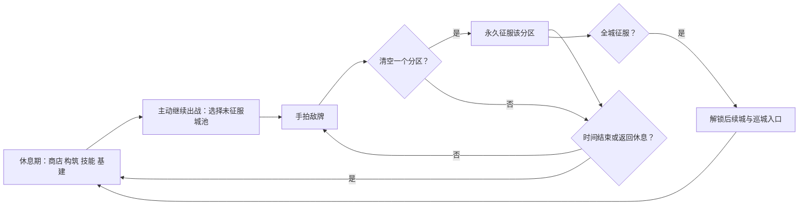

# 01｜游戏总览与当前版本

状态：当前基线｜2026-10-17。

《拍案三国》是一款三国题材的主动拍卡征服游戏。玩家在城池地图中用鼠标拍翻敌牌，赚取金币、征服地图分区，并在休息期调整牌组与技能。玩法的重点是“这一掌拍到哪里、能否把牌聚到一起、下一轮带谁出战”，而不是等待自动产出。

新游戏只有主角I01，仓库和上阵队伍均不附送士兵或武将，也没有初始卡包。主角初始轻拍伤害为1.3，后续通过翻牌、清区奖励和休息期招募逐步扩充队伍。

启动直接进入游戏：新游戏进入新野牌桌，可用当前版本存档则回到休息期。旧主菜单及“返回主界面”出口已从游戏内移除。

## OVERVIEW-01｜单局循环

手拍只打伤敌牌时不发金币或经验；拍翻时逐牌结算金币，一掌只要翻牌就给一次玩家和上阵武将经验。范围或追击翻多牌不重复给本掌经验。分区一旦清空会永久从敌人布局消失；同一城可自由决定先清哪个区。已全清的城不再可挑战，可巡城查看场地；当前巡城不开放事件交互或奖励领取。

## OVERVIEW-02｜当前规模

| 项目 | 当前内容 |
| --- | --- |
| 城池 | 21座，四条路线；新野是第一城 |
| 卡牌数据 | 177张，含8名新增女将；卡包抽士兵、武将、装备与建筑 |
| 敌方地图 | 每城多个固定分区；每个未征服分区独立铺敌 |
| 休息期入口 | 商店、构筑、技能、基建，2×2四格 |
| 基建 | 每征服一区开放该城1槽；恢复装配、移动、卸下、组合收藏与功能加成 |
| 技能 | 9项，用玩家升级给的技能点购买 |
| 地图事件 | 暂停展示；宝箱、剿敌、兑换、护卫的规则与底层数据保留 |
| 存档 | 新档 `save_paan_adventure.json`；旧档不兼容 |

建筑卡重新进入卡包，基建在休息期开放；新野首次征服任一区赠农田与水井。在线、离线与组合自动产金仍为0；旧剧情与自动操作不进入当前循环。★6建筑B29／B30仍缺正常获取入口，不能把保留的功能规则当作已经可收集。

## OVERVIEW-03｜玩家成长

| 成长对象 | 获得方式 | 消费或效果 |
| --- | --- | --- |
| 金币 | 手动拍翻敌牌时按该牌最大HP一次结算；首翻另加8金币 | 买卡包、招降、士兵/装备合成 |
| 玩家经验 | 每次拍翻至少一张敌牌的手掌 +1 | 升级时 +1 技能点 |
| 技能点 | 玩家每升1级 +1 | 每级技能固定消耗1点 |
| 武将经验 | 每次拍翻至少一张敌牌的手掌，所有上阵武将各 +1 | 武将等级提高自身基础战力 |
| 卡牌 | 开包、招降、固定首区奖励 | 构筑、装备、带兵、合成材料 |

没有金币自动增长、离线奖励、自动拍击或“再拍已通关城池”作为成长来源。

## OVERVIEW-04｜本版体验边界

- 战斗中是纯拍击界面：没有升级、商店、构筑、基建、卡池替换、剧情或教学弹层。
- 休息期才允许买包、技能加点、换队、配装备、带兵、合成、招降和基建装配；休息后不会自动重新铺桌。
- 战斗与巡城均不显示宝箱、任务NPC、护卫目标或事件小地图标记；隐藏事件不能接取、开启或领取奖励。
- 已完成的城可巡城查看场地，没有敌牌、倒计时、挂机、事件奖励或复刷金币。
- 当前剧情内容只保留在历史资源中，运行流程不触发、不显示、不保存“已读”。

## OVERVIEW-05｜本文件后续怎么改

适合直接改：主循环、休息期入口数量、主要成长来源、是否允许重复挑战。

改“每一掌如何结算”请到[02 战斗与事件](02_操作与战斗循环.md)；改地图与区域请到[03 地图城池与进度](03_地图城池与关卡进度.md)。
