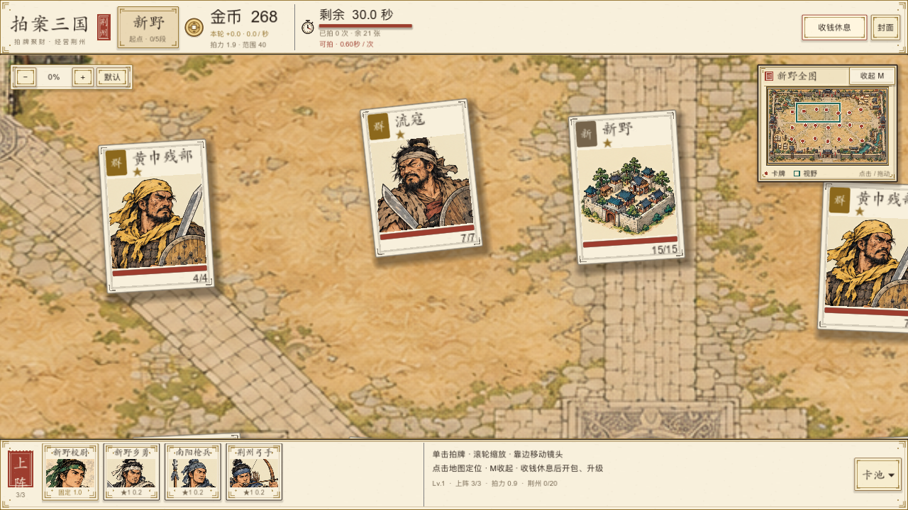
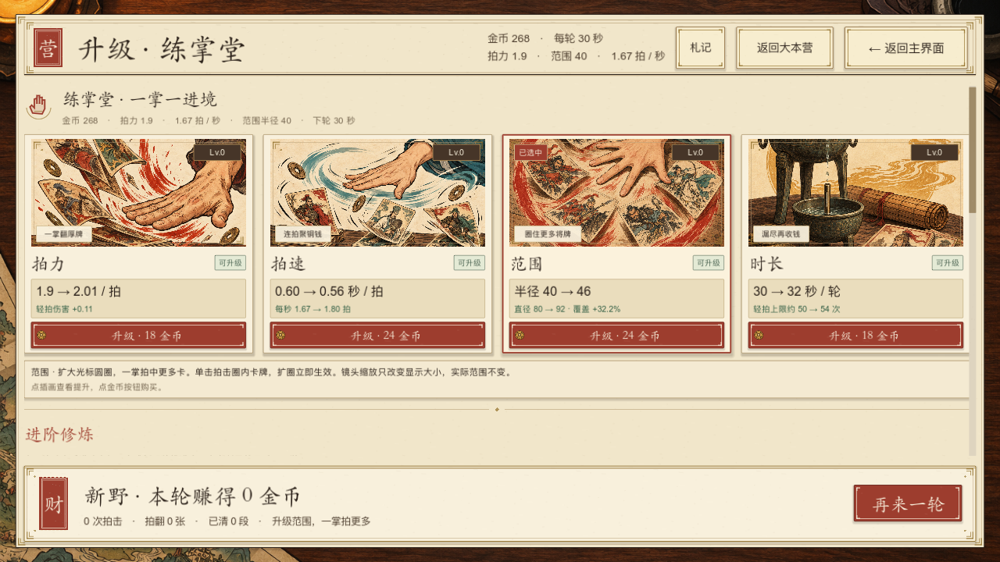
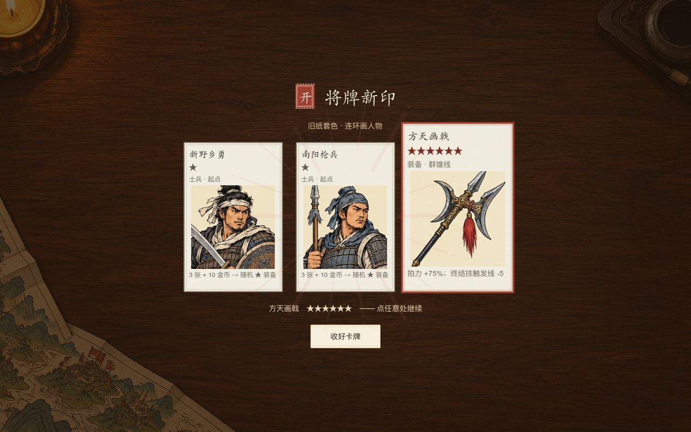

# 历史表现参考截图

以下是本轮分区永久征服改版之前的原生Godot窗口截图，保存在策划文件夹内以便前后对照。它们不是新实现的验收图：旧战斗图中的“卡池”“封面”入口、旧升级图的“再来一轮”文案和自动经营分组，已不代表当前代码。

| 文件 | 用途 |
| --- | --- |
| [拍牌_1280x720.png](拍牌_1280x720.png) | 旧版默认0%近景、休息按钮、底部上阵与小地图；未显示固定分区，战斗仍有旧管理入口 |
| [升级_1280x720.png](升级_1280x720.png) | 旧版休息期四项基础升级、价格与范围40→46布局；进阶内容/战果按钮已调整 |
| [开包_1280x800.png](开包_1280x800.png) | 木桌揭牌、卡面和高星特写完成状态的历史对照；静态图不证明逐张运动过程 |

当前实机图：[720拍击](分区改版_1280x720/play.png)、[720营地](分区改版_1280x720/camp.png)、[720聚拢](分区改版_1280x720/gather.png)、[720基建](分区改版_1280x720/base.png)；[800拍击](分区改版_1280x800/play.png)、[800营地](分区改版_1280x800/camp.png)、[800基建](分区改版_1280x800/base.png)。验证范围见[本轮记录](../实现对照/分区改版验证记录.md)。可以在第09章说明希望变化的位置、颜色、大小、材质与动效；新图不覆盖这些历史参考。
